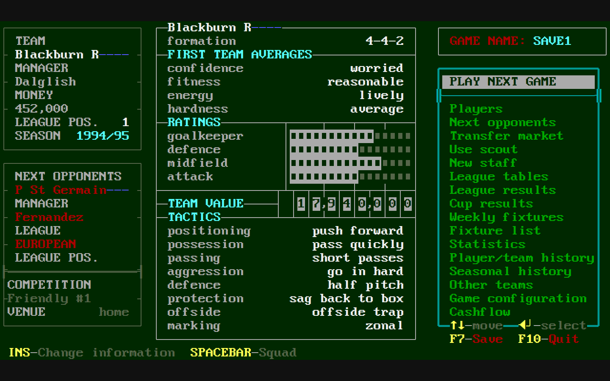
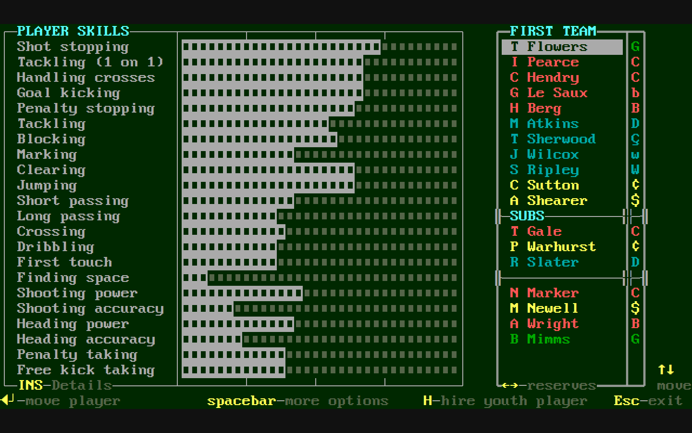
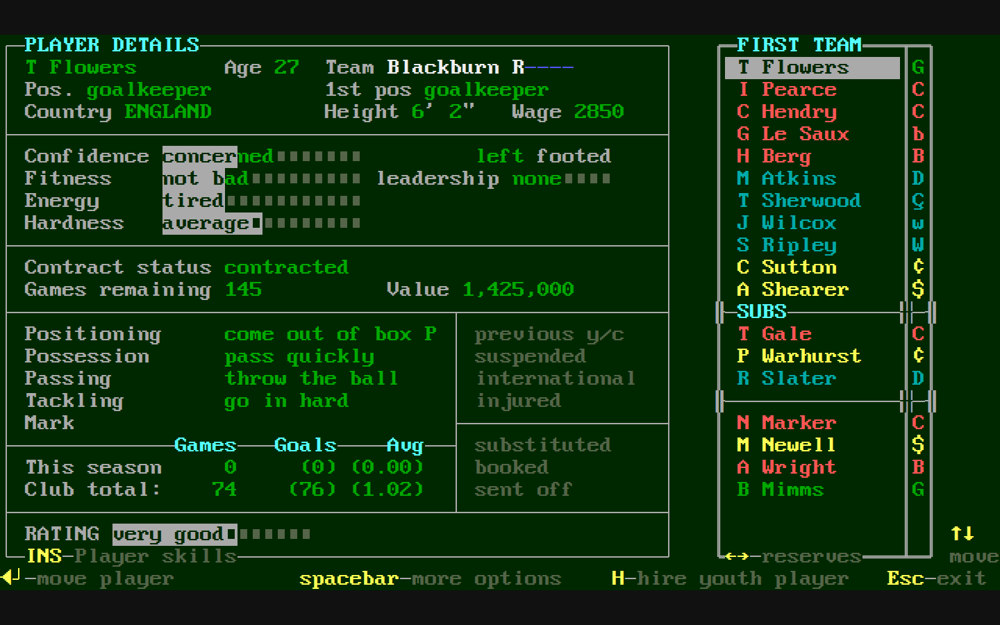
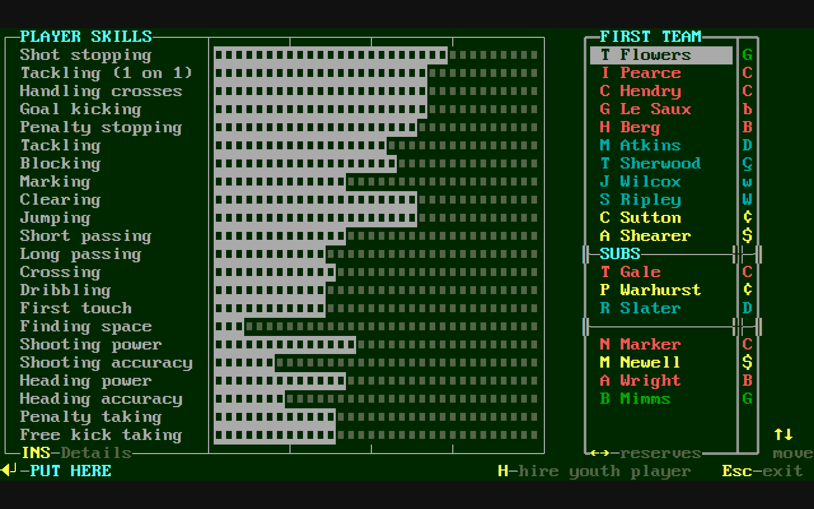
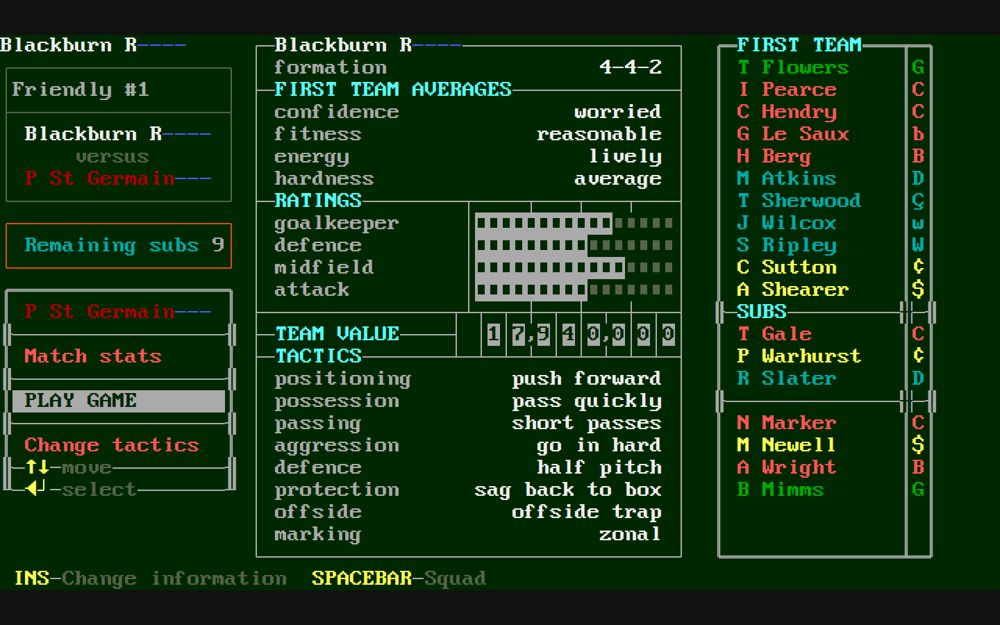
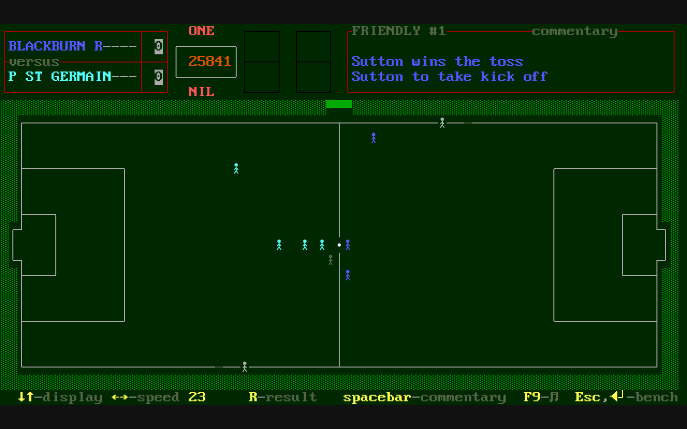
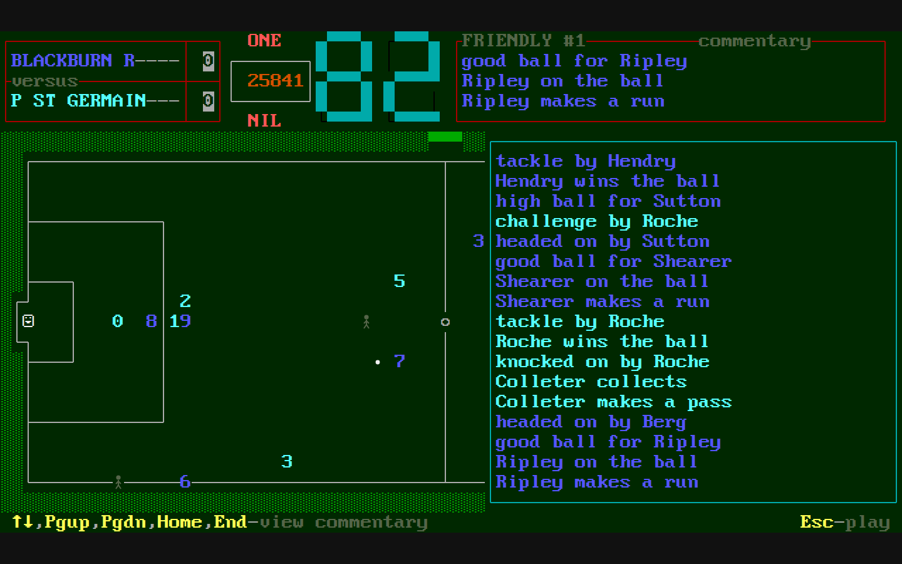
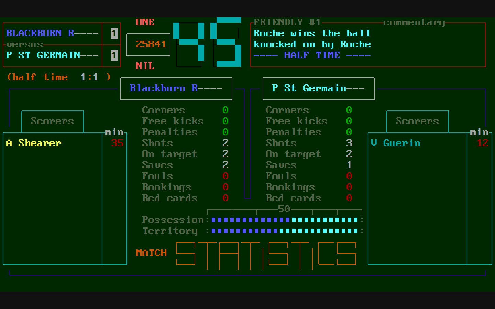
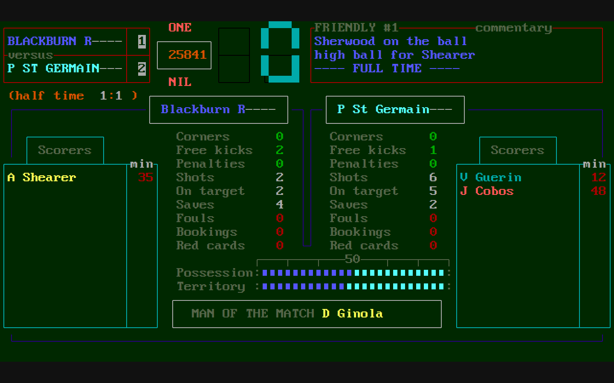

# Faithful desktop visual study

[designed] **Static proposed screens for owner inspection.** These pictures are not a running game, a chosen toolkit or approval of the listed differences. Desktop remains the primary product; the headless browser is only the design screenshot tool.

[confirmed: render receipt] The final study uses [render-r0003](../../records/T51/render-r0003.json), with ten variants at three sizes (30 PNGs), exact source/asset/runtime hashes and unclipped screen/text geometry. The [complete screen map](screen-map.md) separately covers83 workflows/18menu slots/20families and all14 gap groups.

## Original and proposed, side by side

[confirmed] Original images and records are pinned to accepted research `6aca98caeebc1b9b5410852139fa305462224a05`. Each proposed screen independently renders captured display content with a licensed replacement font and vector primitives; it does not paste the original image. Capture values are scenario facts, not new-career defaults.

## Weekly main menu

[designed] Original three-column landing screen; menu, central information and footer stay together.

| Original reference | Proposed desktop composition |
| --- | --- |
|  |  |

[Original record](https://github.com/diegoami/onenil-archaeology/blob/6aca98caeebc1b9b5410852139fa305462224a05/runs/T41/T41-r0002/record.json) · [Full proposed PNG](../../records/T51/render-r0003-main-desktop.png) · [960×640 study](../../records/T51/render-r0003-main-compact.png) · [720×450 at2×](../../records/T51/render-r0003-main-hidpi.png) · [SVG source](mockups/pages/main.svg)

**Declared differences:** P01, P02.

## Players · skills

[designed] Full22 skill bars beside original roster and role column; no aggregate skill table.

| Original reference | Proposed desktop composition |
| --- | --- |
|  |  |

[Original record](https://github.com/diegoami/onenil-archaeology/blob/6aca98caeebc1b9b5410852139fa305462224a05/runs/T45/session-r0001/step-0003.json) · [Full proposed PNG](../../records/T51/render-r0003-skills-desktop.png) · [960×640 study](../../records/T51/render-r0003-skills-compact.png) · [720×450 at2×](../../records/T51/render-r0003-skills-hidpi.png) · [SVG source](mockups/pages/skills.svg)

**Declared differences:** P01, P02, P03.

## Players · details

[designed] Insert replaces skills with the complete player details while keeping selected identity.

| Original reference | Proposed desktop composition |
| --- | --- |
|  |  |

[Original record](https://github.com/diegoami/onenil-archaeology/blob/6aca98caeebc1b9b5410852139fa305462224a05/runs/T45/session-r0001/step-0004.json) · [Full proposed PNG](../../records/T51/render-r0003-details-desktop.png) · [960×640 study](../../records/T51/render-r0003-details-compact.png) · [720×450 at2×](../../records/T51/render-r0003-details-hidpi.png) · [SVG source](mockups/pages/details.svg)

**Declared differences:** P01, P02, P03.

## Players · PUT HERE

[designed] Keep carried-player card separate from destination highlight; Escape cancels this pre-match move.

| Original reference | Proposed desktop composition |
| --- | --- |
|  |  |

[Original record](https://github.com/diegoami/onenil-archaeology/blob/6aca98caeebc1b9b5410852139fa305462224a05/runs/T46/session-r0001/step-0003.json) · [Full proposed PNG](../../records/T51/render-r0003-put-here-desktop.png) · [960×640 study](../../records/T51/render-r0003-put-here-compact.png) · [720×450 at2×](../../records/T51/render-r0003-put-here-hidpi.png) · [SVG source](mockups/pages/put-here.svg)

**Declared differences:** P01, P02, P03.

## Match preparation

[designed] Original PLAY GAME default and opponent/statistics/tactics menu, team panel and roster.

| Original reference | Proposed desktop composition |
| --- | --- |
|  |  |

[Original record](https://github.com/diegoami/onenil-archaeology/blob/6aca98caeebc1b9b5410852139fa305462224a05/runs/T47/session-r0001/step-0011.json) · [Full proposed PNG](../../records/T51/render-r0003-preparation-desktop.png) · [960×640 study](../../records/T51/render-r0003-preparation-compact.png) · [720×450 at2×](../../records/T51/render-r0003-preparation-hidpi.png) · [SVG source](mockups/pages/preparation.svg)

**Declared differences:** P01, P02, P03.

## Watched match · live pitch

[designed] Original score/indicators and short commentary above the large pitch; contextual keys below.

| Original reference | Proposed desktop composition |
| --- | --- |
|  |  |

[Original record](https://github.com/diegoami/onenil-archaeology/blob/6aca98caeebc1b9b5410852139fa305462224a05/runs/T48/session-r0001/step-0003.json) · [Full proposed PNG](../../records/T51/render-r0003-pitch-desktop.png) · [960×640 study](../../records/T51/render-r0003-pitch-compact.png) · [720×450 at2×](../../records/T51/render-r0003-pitch-hidpi.png) · [SVG source](mockups/pages/pitch.svg)

**Declared differences:** P01, P02, P04.

## Watched match · commentary history

[designed] Detailed action history is an overlay over the live screen; keep its paging keys and return.

| Original reference | Proposed desktop composition |
| --- | --- |
|  |  |

[Original record](https://github.com/diegoami/onenil-archaeology/blob/6aca98caeebc1b9b5410852139fa305462224a05/runs/T48/session-r0001/step-0020.json) · [Full proposed PNG](../../records/T51/render-r0003-history-desktop.png) · [960×640 study](../../records/T51/render-r0003-history-compact.png) · [720×450 at2×](../../records/T51/render-r0003-history-hidpi.png) · [SVG source](mockups/pages/history.svg)

**Declared differences:** P01, P02, P04.

## Watched match · live bench

[designed] Live bench retains original remaining-sub display and context; not a second preparation instance.

| Original reference | Proposed desktop composition |
| --- | --- |
|  |  |

[Original record](https://github.com/diegoami/onenil-archaeology/blob/6aca98caeebc1b9b5410852139fa305462224a05/runs/T48/session-r0001/step-0004.json) · [Full proposed PNG](../../records/T51/render-r0003-bench-desktop.png) · [960×640 study](../../records/T51/render-r0003-bench-compact.png) · [720×450 at2×](../../records/T51/render-r0003-bench-hidpi.png) · [SVG source](mockups/pages/bench.svg)

**Declared differences:** P01, P02, P03.

## Watched match · halftime board

[designed] Actual halftime board precedes bench access; preserve supplied statistics and acknowledgement.

| Original reference | Proposed desktop composition |
| --- | --- |
|  |  |

[Original record](https://github.com/diegoami/onenil-archaeology/blob/6aca98caeebc1b9b5410852139fa305462224a05/runs/T48/session-r0001/step-0035.json) · [Full proposed PNG](../../records/T51/render-r0003-halftime-desktop.png) · [960×640 study](../../records/T51/render-r0003-halftime-compact.png) · [720×450 at2×](../../records/T51/render-r0003-halftime-hidpi.png) · [SVG source](mockups/pages/halftime.svg)

**Declared differences:** P01, P02.

## Watched match · final statistics

[designed] Actual completed-match exit reaches final board before cashflow/news/next-week continuation.

| Original reference | Proposed desktop composition |
| --- | --- |
|  |  |

[Original record](https://github.com/diegoami/onenil-archaeology/blob/6aca98caeebc1b9b5410852139fa305462224a05/runs/T48/session-r0001/step-0061.json) · [Full proposed PNG](../../records/T51/render-r0003-fulltime-desktop.png) · [960×640 study](../../records/T51/render-r0003-fulltime-compact.png) · [720×450 at2×](../../records/T51/render-r0003-fulltime-hidpi.png) · [SVG source](mockups/pages/fulltime.svg)

**Declared differences:** P01, P02.

## Proposed differences and unresolved fidelity

| ID | Difference | Reason and acceptance status |
| --- | --- | --- |
| P01 | Independent VGA-style replacement font rather than One-Nil private custom font | Reproducible new rendering without original font bytes; exact letterforms/width treatment remain a visual comparison point; **proposed-not-owner-approved** |
| P02 | Uniform scalable desktop surface with letterboxing | Retain original composition/information at documented viewport sizes; this does not establish final minimum window size or supported platform/DPI; **proposed-not-owner-approved** |
| P03 | Roster role cells use captured decoded aliases in replacement font | Original role font has custom glyphs not reliably mapped by CP437; do not treat aliases as a verified visual or semantic mapping; **unresolved-glyph-fidelity** |
| P04 | Independently drawn schematic player/ball markers at captured text-cell positions | Do not copy original sprites; these static quantized positions are not a native engine-coordinate or action-parity claim; **proposed-not-owner-approved** |

[designed] Font substitution also affects custom large clock/scoreboard lettering and some mixed border glyphs. Those shapes and decoded roster aliases are not verified original glyph mappings or a claim that the mockups interpret every clock cell correctly. Captured clock glyphs are design input, not a fabricated minute value. These details need explicit native rendering/field checks in desktop feasibility; no goal2-specific role or clock rule is imported.

[designed] Scaling keeps the complete logical720×400 surface and adds letterboxing rather than rearranging the game into web cards. At the tested sizes the full screen and text bounds remain inside the viewport. The compact and2× sheets demonstrate that proposal only: they do not certify an OS, physical display size, accessibility or final supported minimum window.

## What the checks establish

[confirmed] `build.py` checks the required ten variant identities, original record/PNG hashes, generated-page drift and the independent font hash. Five corruption cases are rejected (missing/duplicate variant, unknown departure, changed original record hash, changed original image hash). A separate [wrong-font run](../../records/T51/bad-font-r0001.json) is correctly refused. [Public font fetch](../../records/T51/font-fetch-r0002.json) verifies the official pack/member checksums; the [first fetch](../../records/T51/font-fetch-r0001.json) retained its403 failure before the client supplied its identifying User-Agent. Font binary and original game files stay outside git.

[confirmed] Render-r0001 passed geometry but visual inspection found missing inverse filled-bar appearance. Render-r0002 corrected bars; render-r0003 adds continuous independent vector frames/block primitives. Earlier sheets/receipts are retained, not rewritten. Final PNGs are referenced above. Geometry/hash success is not owner visual acceptance or a product parity verdict.

## Next desktop feasibility slice

[designed] Use the original-matched main-menu/Players/pitch compositions to assess native desktop candidates. Prove actual keyboard/default/return behavior, carried-player identity, local file persistence and one owned Rust event/decision/result lifecycle, with responsive cancellation/shutdown and no manually started browser/server as the play path. Resolve role/clock glyphs and show any remaining difference explicitly. Owner toolkit selection on #103 follows that evidence; B1–B6 then connect real campaign state.

[designed] This inspection package does not start or delegate a milestone review. No changed game rule, control meaning, original palette/font asset reuse or silent visual departure is approved by it.

[Reproduction and font attribution](mockups/README.md) · [Generator](mockups/build.py) · [Design inputs/ledger](mockups/design.json)
